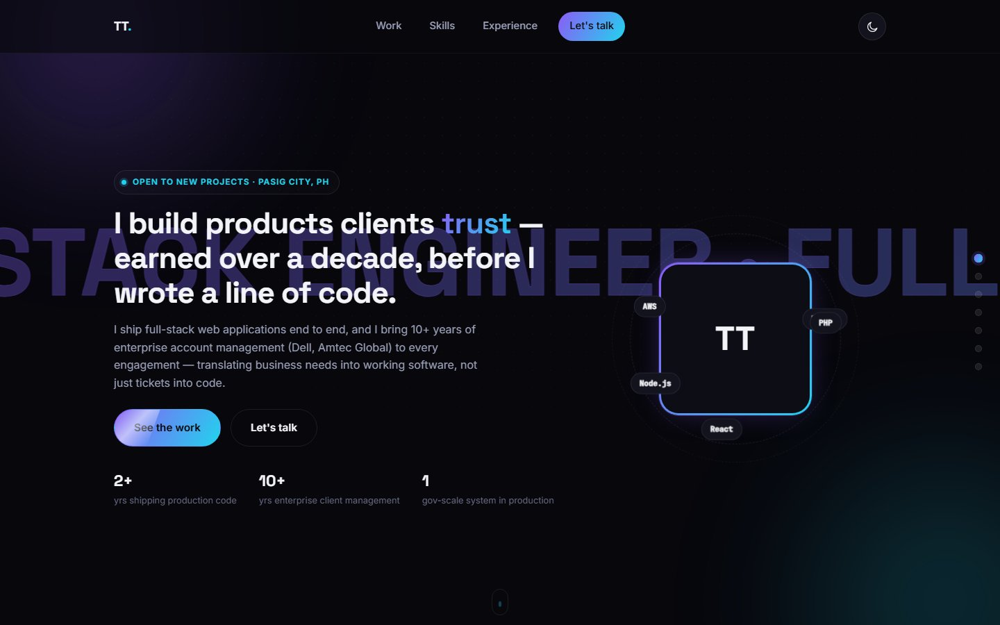

# Terence Tagayona: Portfolio

My personal portfolio: a single-page site with my background, a carousel of featured projects with case studies, my skills and my experience. It is written in plain **HTML, CSS and JavaScript**, with no framework and no build step.



## Featured projects

| Project | What it is | Links |
|---|---|---|
| **QC-SSDD Service Tracker** | A full-stack benefits-management platform for the Quezon City Social Services Development Department, built through Sparksoft Solutions. | Case study on the site |
| **Kabahagi Case Management System** | A hardened case and lead management platform for social services casework. | Case study on the site |
| **Sales Offshore** | The marketing and lead-generation site for an outsourced sales agency. React, Vite, Tailwind CSS. | [Live site](https://www.salesoffshoreph.com) · [Code](https://github.com/Terence1925/sales-offshore-elevate) |
| **MyFit** | A workout and calorie tracker with 12-week programs, a cookbook and an Android app. React, Supabase, Capacitor. | [Live app](https://getmyfit.vercel.app) · [Code](https://github.com/Terence1925/myfit) |
| **Wanderly** | An AI travel planner with streaming itineraries on a live map and real-time collaboration. Next.js, Supabase, Claude API. | [Live app](https://wanderly-ai-travel-planner-five.vercel.app) · [Code](https://github.com/Terence1925/wanderly-ai-travel-planner) |

Client names and identifiers in the work screenshots are redacted for privacy.

## On the page

- A work carousel with case studies, which also works with swipe, arrow keys and autoplay.
- Animated section reveals, 3D tilt on cards, and a light and dark theme switch.
- Sections for about, stack, work, skills, experience and contact.

## Run it locally

There is nothing to install. Open `index.html` in a browser, or serve the folder:

```bash
python -m http.server 8000
```

then visit http://localhost:8000.

## Files

```
index.html    the page
styles.css    all styling
script.js     the carousel, reveals, theme switch and other behavior
assets/       images, the resume and the favicon
docs/         the screenshot used in this README
```
